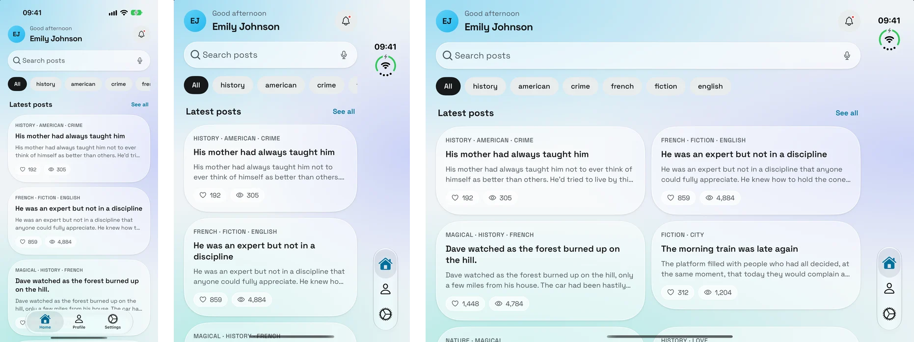
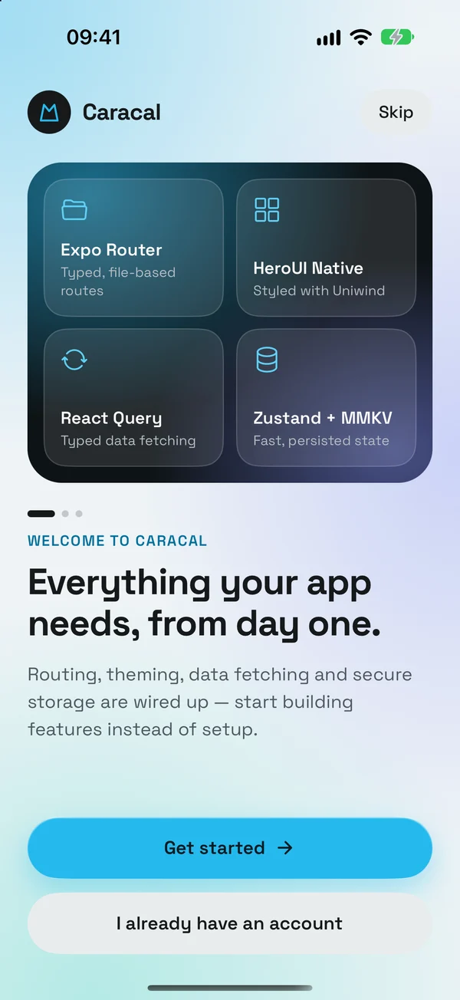
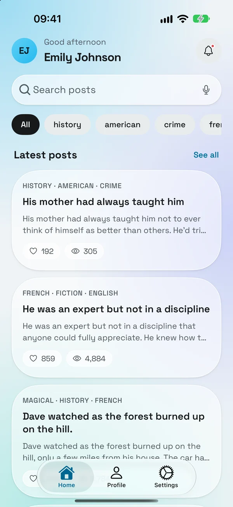
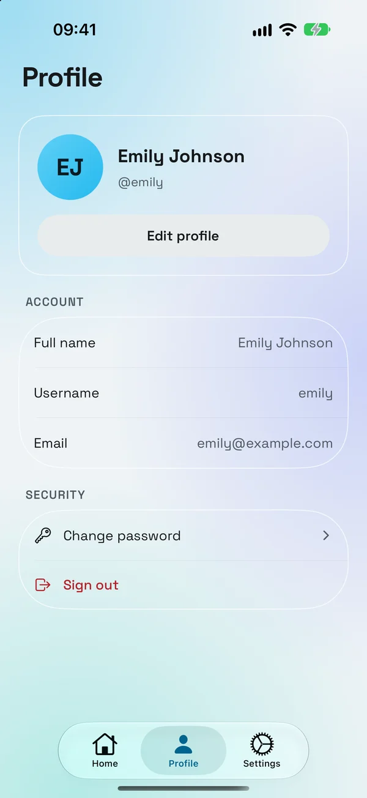
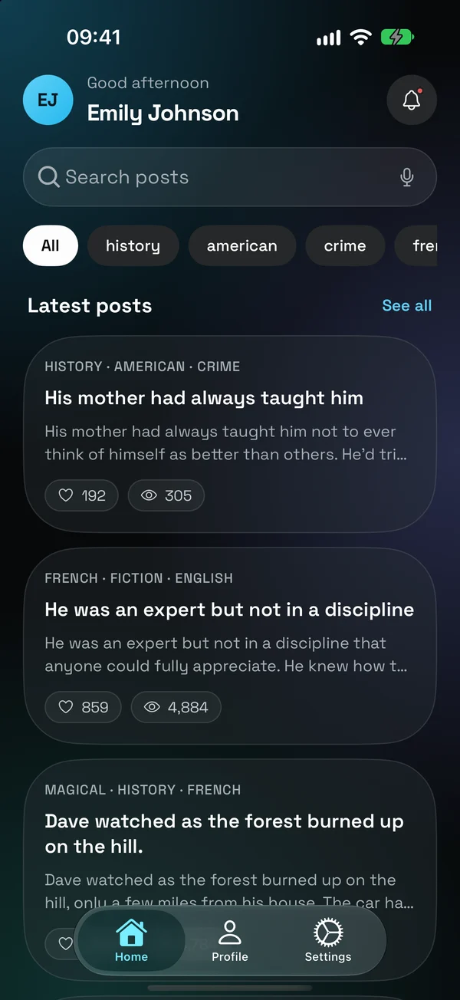
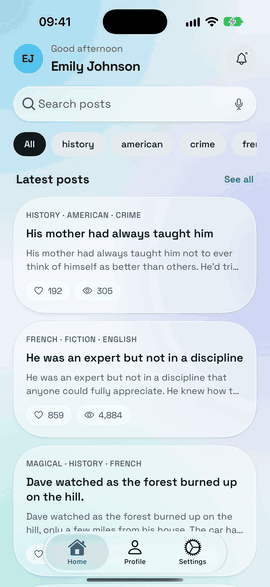
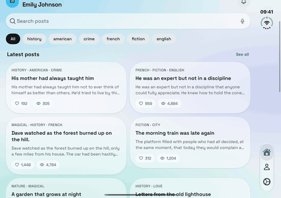

<p align="center">
    
</p>

<h1 align="center">
  React Native Template Caracal
</h1>

     

📱 A template for your next React Native project 🚀, Made with developer experience and performance first: Expo, TypeScript, TailwindCSS, Husky, Lint-Staged, expo-router, react-query, react-hook-form, I18n.

> Welcome to the Caracal's Expo / React Native Starter Kit!

## 🚀 Motivation

The goal of this starter kit is to streamline the process of building React Native apps. It provides a resource for creating high-quality apps faster and with less effort, while ensuring projects adhere to consistent code standards and architectural principles.

The benefits of using this starter kit are numerous. It provides a consistent foundation that makes it easy to switch between projects and focus on business logic rather than boilerplate code. Because it promotes consistency, it makes apps easier to maintain and scale.

Overall, this starter kit is designed to facilitate efficient and effective app development, helping you bring the best possible products to your users.

## ✍️ Philosophy

When creating this starter kit, we had several guiding principles in mind::

- **🚀 Production-ready**: We wanted to ensure that this starter was ready for real-world use, providing a solid foundation for building production-grade apps.
- **🥷 Developer experience and productivity**: Our focus was on creating a starter that would enhance the developer experience and increase productivity.
- **🧩 Minimal code and dependencies**: We aimed to keep the codebase and dependencies as small as possible.
- **💪 Well-maintained third-party libraries**: We included only well-maintained and reliable third-party libraries, to provide stability and support for our projects.

## ⭐ Key Features

- ✅ Latest Expo SDK with Custom Dev Client: Leverage the best of the Expo ecosystem while maintaining full control over your app.
- 🎉 [TypeScript](https://www.typescriptlang.org/) for enhanced code quality and bug prevention through static type checking.
- 💅 Minimal UI kit built with [TailwindCSS](https://docs.uniwind.dev/), featuring common components essential for your app.
- 🪟 iOS 26 liquid glass UI with light and dark themes.
- 📱 Adaptive layouts for iPhone Duo, iPad and Android foldables: safe-area aware, with a two-column feed on wide windows.
- ⚙️ Multi-environment build support (Production, Staging, Development) using Expo configuration.
- 🦊 Husky for Git Hooks: Automate your git hooks and enforce code standards.
- 💡 Clean project structure with Absolute Imports for easier code navigation and management.
- 🚫 Lint-staged: Run Eslint and TypeScript checks on Git staged files to maintain code quality.
- 🗂 VSCode recommended extensions, settings, and snippets for an enhanced developer experience.
- ☂️ Pre-installed [Expo Router](https://docs.expo.dev/router/introduction/) with examples for comprehensive app navigation.
- 💫 Auth flow implementation using [Zustand](https://github.com/pmndrs/zustand) for state management and [react-native-mmkv](https://github.com/mrousavy/react-native-mmkv) for secure data storage.
- 🛠 10+ [Github Actions](https://github.com/features/actions) workflows for building, releasing, testing, and distributing your app.
- 🔥 [React Query](https://react-query.tanstack.com/) and [axios](https://github.com/axios/axios) for efficient data fetching and state management.
- 🧵 Robust form handling with [react-hook-form](https://react-hook-form.com/) and [zod](https://github.com/colinhacks/zod) for validation, plus keyboard handling.
- 🎯 Localization support with [i18next](https://www.i18next.com/), including Eslint for validation.
- 🧪 Unit testing setup with [Jest](https://jestjs.io/) and [React Testing Library](https://testing-library.com/docs/react-testing-library/intro/).
- 🔍 E2E testing capabilities with [Maestro](https://maestro.mobile.dev/) for comprehensive app testing.

## Is this starter for me?

Yes 😀

This starter kit is designed to benefit a wide range of React Native developers, from beginners to experienced professionals. Here's why it might be a good fit for you:

1. **For beginners:** It provides a solid foundation with best practices and common solutions, helping you learn industry-standard approaches to React Native development.

2. **For experienced developers:** It offers a well-structured, production-ready setup that can save you time and effort in project initialization and configuration.

3. **For teams:** It ensures consistency across projects and team members, making it easier to onboard new developers and maintain code quality.

4. **For explorers:** Even if you prefer not to use starter kits, this project can serve as a valuable reference. You can explore the codebase, documentation, and architectural decisions to gain insights and potentially adopt specific solutions for your projects.

5. **For learners:** The starter kit incorporates up-to-date libraries and patterns, allowing you to familiarize yourself with current best practices in the React Native ecosystem.

6. **For AI-assisted development:** This starter kit works well with AI coding tools. It provides a solid structure and best practices that can guide AI-generated code. This helps ensure that AI assistance leads to high-quality, maintainable code that fits well within your project.

Remember, you don't have to use the entire starter kit as-is. Feel free to cherry-pick ideas, configurations, or code snippets that align with your project needs. Whether you're building a new app from scratch or looking to improve your existing development process, this starter kit can provide valuable insights and practical solutions.

## Why Expo and not React Native CLI?

We have been using Expo as our main framework since the introduction of [Continuous Native Generation (CNG)](https://docs.expo.dev/workflow/continuous-native-generation/) concept and we are happy with the experience.

I think this question is not valid anymore, especially after the last React conference when the core React native team recommended using Expo for new projects.

> "As of today, the only recommended community framework for React Native is Expo. Folks at Expo have been investing in the React Native ecosystem since the early days of React Native and as of today, we believe the developer experience offered by Expo is best in class." React native core team

Still hesitating? Check out this [article](https://reactnative.dev/blog/2024/06/25/use-a-framework-to-build-react-native-apps) or this [video](https://www.youtube.com/watch?v=lifGTznLBcw), maybe this one [video](https://www.youtube.com/watch?v=ek_IdGC0G80) too.

## 🧑‍💻 Stay up to date

This starter kit is continually improved with new features and bug fixes.

If you want to stay up to date with the latest developments, you can either watch the repository or hit the "star" button. This will allow you to receive notifications whenever new updates are available.

Feedback and suggestions are always welcome. Feel free to open an issue or discussion to share your thoughts.

## 📸 Screenshots

<p align="center">
  
  <br />
  <sub>iPhone 18 Pro · iPhone Duo (closed) · iPhone Duo (open)</sub>
</p>

<table align="center">
  <tr>
    <td></td>
    <td></td>
    <td></td>
    <td></td>
  </tr>
</table>

<p align="center">
  
</p>

### Ready for iPhone Duo

Layouts follow the safe area on the cover display, where the tab bar sits on the side, and use the extra width on the inner display with a two-column feed. See the [iPhone Duo guide](https://react-native-template-atlas.vercel.app/docs/ui-and-theme/iphone-duo).

<p align="center">
  
</p>

## 💎 Libraries used

- [Expo](https://docs.expo.io/)
- [Expo Router](https://docs.expo.dev/router/introduction/)
- [Uniwind](https://docs.uniwind.dev/)
- [HeroUI Native](https://v3.heroui.com/docs/native/getting-started)
- [Flash list](https://github.com/Shopify/flash-list)
- [React Query](https://tanstack.com/query/v4)
- [Axios](https://axios-http.com/docs/intro)
- [React Hook Form](https://react-hook-form.com/)
- [i18next](https://www.i18next.com/)
- [zustand](https://github.com/pmndrs/zustand)
- [React Native MMKV](https://github.com/mrousavy/react-native-mmkv)
- [React Native Gesture Handler](https://docs.swmansion.com/react-native-gesture-handler/docs/)
- [React Native Reanimated](https://docs.swmansion.com/react-native-reanimated/docs/)
- [React Native Svg](https://github.com/software-mansion/react-native-svg)
- [React Error Boundaries](https://github.com/bvaughn/react-error-boundary)
- [Expo Image](https://docs.expo.dev/versions/unversioned/sdk/image/)
- [React Native Keyboard Controller](https://github.com/kirillzyusko/react-native-keyboard-controller)
- [React Native Safe Area Context](https://github.com/th3rdwave/react-native-safe-area-context)
- [React Native Screens](https://github.com/software-mansion/react-native-screens)
- [Tailwind Variants](https://www.tailwind-variants.org/)
- [Zod](https://zod.dev/)

## ⚡ Build Configuration

Caracal is tuned for build throughput out of the box:

- **Prebuilt React Native.** `buildReactNativeFromSource` is off, so the RN C++ core
  and Hermes are not recompiled on every build.
- **Gradle daemon, parallel builds and build cache**, via the
  `plugins/with-gradle-performance.js` config plugin. The daemon is disabled
  automatically on EAS, where a throwaway container gains nothing from it.
- **arm64-only development builds.** Release builds also include `armeabi-v7a`
  for legacy 32-bit handsets.

**Note on Intel Macs:** development builds target `arm64-v8a` only, so an
x86/x86_64 Android emulator will not install them. On an Intel machine, add
`'x86_64'` to `android.buildArchs` in `app.config.ts` and re-run `pnpm prebuild`.

Fonts and icons are imported by subpath rather than through the package barrel,
which keeps unused weights and icon families out of the native build. An ESLint
rule enforces this — see the [Fonts docs](https://react-native-template-atlas.vercel.app/docs/ui-and-theme/fonts).

## AI Configuration

This repository includes a root `llms.txt` file that defines canonical documentation for AI tools.

## 📚 Documentation

Full documentation is available at [react-native-template-atlas.vercel.app](https://react-native-template-atlas.vercel.app) (deployed on Vercel from the `docs/` directory).

To run the docs locally:

```bash
cd docs
pnpm install --ignore-workspace
pnpm dev
```

## 👤 Maintainer

This starter is maintained by [Tuan Anh Le](https://leanhtuan1994.github.io/team).

For custom projects and consulting, visit [leanhtuan1994.github.io/contact](https://leanhtuan1994.github.io/contact).

## 🙏 Credits

Caracal is built on the [Obytes React Native starter](https://github.com/obytes/react-native-template-obytes), used under the MIT License. Thanks to the Obytes team for the foundation.

## ❓ FAQ

If you have any questions about the starter, please open an [issue](https://github.com/leanhtuan1994/react-native-caracal/issues).

## 🔖 License

This project is MIT licensed.
